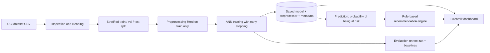

# AI-Based Personalized Learning and Student Performance Prediction System
**A Data-Driven Approach to Identifying Learning Gaps and Guiding Focused Revision**

Course project - Deep Learning (DSE3120), Department of Data Science, Manipal University Jaipur
Student: Prithvi Phogat (Reg. No. 2430010010) | Supervisor: Dr. DP Sharma

> **Honest status note.** This project was written and tested in an environment with **no internet, no TensorFlow
> and no Streamlit**. Everything that could be run there was run (see [What was tested](#what-was-tested)), but the
> **TensorFlow/Keras ANN has not been executed by the author** and **no real data has been downloaded or trained on**.
> You produce the real results by running the commands below on your own computer. No result numbers appear in
> this README on purpose.

## 1. Problem statement
Students often notice too late that they are falling behind. Using school records, can we estimate early whether a
student is **at risk of finishing below the pass mark**, and give simple, transparent revision suggestions?

## 2. Objectives
1. Demonstrate the full Deep Learning workflow on real, open data.
2. Train an Artificial Neural Network (TensorFlow/Keras) and compare it honestly with simpler baselines.
3. Provide a dashboard to explore data, predict, read recommendations and inspect model quality.
4. Keep the recommendation logic separate, understandable and evidence-based.

## 3. Features
* Home dashboard, Performance Analysis, Prediction, Recommendations, Model Insights, About.
* Prediction form generated from one schema (`src/schema.py`) with input validation.
* Saved model + preprocessing; the app never retrains.
* Baselines (majority class, logistic regression, "G2 below pass mark" rule), bootstrap intervals, permutation importance.
* Rule-based recommendations that show the rule and the evidence behind each suggestion.
* Clear empty/error states, demo-mode warnings, anonymised data only.

## 4. Technology stack
Python - TensorFlow/Keras - scikit-learn - pandas/NumPy - Matplotlib - Streamlit - PyYAML/joblib - unittest/pytest.
(Plotly was deliberately not used: Matplotlib is enough and keeps dependencies small.)

## 5. Dataset (and why it was chosen)
**Primary: UCI Student Performance, Mathematics file** (CC BY 4.0, DOI 10.24432/C5TG7T, 395 students, two Portuguese
secondary schools). Details and citation: [data/README.md](data/README.md).

| Option | Verdict |
|---|---|
| **UCI Student Performance** | **Chosen.** Small download (~40 KB), documented columns, clear licence, grades + study indicators, easy to explain in a viva. Weakness: only ~395 rows and no topic-level data. |
| OULAD (Open University) | Rich VLE click-stream and assessment tables, but large, multi-table, and needs substantial aggregation; no per-topic mastery labels either. Good future extension. |
| ASSISTments | Suits skill-level correctness prediction; not chosen because it needs a different task and data handling. Future extension. |

In the authoring environment only the UCI web page could be inspected: I checked every column the model uses (G1, G2, G3,
studytime, absences, failures, traveltime, freetime, goout, schoolsup, famsup, paid, activities, higher, internet) and its documented
value range against the official variable table (33 variables, no missing values, 39.8 KB download, CC BY 4.0). The CSV files
themselves could not be downloaded there, so the loader has **not yet read the real file**; if a column name differs on your
copy, `load_raw_dataset` stops and lists the missing columns.

## 6. Prediction target and inputs
* **Target `at_risk`** = 1 if the final grade `G3` < 10, else 0. Grades are on the Portuguese 0-20 scale, where 10 is the
  pass mark (configurable in `config/config.yaml`). The model outputs the **probability of being at risk**.
* **Inputs (14)**: `G1`, `G2` (period grades), `studytime`, `absences`, `failures`, `traveltime`, `freetime`, `goout`,
  `schoolsup`, `famsup`, `paid`, `activities`, `higher`, `internet`.
* **Not used on purpose**: `G3` (it defines the target - no leakage), sex, age, address, family structure, parents'
  education/jobs, alcohol use, romantic status, health, school. This keeps suggestions actionable and avoids profiling on
  personal characteristics.
* **G1/G2 caveat**: the dataset authors note G3 is strongly tied to G1/G2, so including them makes the task easier.
  Run `python scripts/train.py --no-prior-grades` for the harder experiment without them.
* **Splitting**: stratified 60% train / 20% validation / 20% test (seed 42). One row = one student, so no student is split
  across sets. Do **not** merge the Math and Portuguese files: many students appear in both, which would leak information across splits.

## 7. Architecture

**The ANN and the recommendation engine are different things.** The ANN (trained, `src/model.py`) outputs a risk probability.
The recommendation engine (`src/recommendations.py`) is a hand-written rule set that reads the same inputs; it is not
learned and not generative AI.

**ANN**: `Input(14) -> Dense(64, ReLU) -> Dropout(0.3) -> Dense(32, ReLU) -> Dropout(0.3) -> Dense(1, sigmoid)`;
binary cross-entropy loss; Adam (lr 0.001); L2 1e-4; batch 32; up to 300 epochs; early stopping on validation loss
(patience 25, best weights restored); balanced class weights; decision threshold 0.5 fixed in advance.

## 8. Directory structure
```
student-learning-prediction/
├── app.py                      # Home dashboard
├── pages/                      # 1_Performance_Analysis, 2_Prediction, 3_Recommendations, 4_Model_Insights, 5_About
├── src/                        # schema, data_loader, preprocessing, model, train_model, evaluate_model,
│                               # predict, recommendations, eda, demo_data, ui_components, utils
├── scripts/                    # check_setup, download_data, make_demo_data, run_eda, train, evaluate, run_pipeline
├── config/config.yaml          # all settings (paths, split, hyperparameters, thresholds)
├── tests/                      # unittest-style tests (also run by pytest)
├── data/  models/  reports/    # inputs, saved artifacts, evaluation outputs (generated)
├── docs/PROJECT_REPORT.md      # university report
├── VIVA_PREPARATION.md         # 40 viva questions and answers
├── requirements.txt  setup_windows.ps1  run_all.ps1  LICENSE  .gitignore
```

## 9. Installation (Windows PowerShell)
```powershell
cd student-learning-prediction
python -m venv .venv
.\.venv\Scripts\Activate.ps1          # if blocked: Set-ExecutionPolicy -Scope Process Bypass
python -m pip install --upgrade pip
pip install -r requirements.txt
```
(`.\setup_windows.ps1` does the same. `.\run_all.ps1` does everything in one go: install, preflight check, data download, training, evaluation, tests, dashboard - it has not been run by the author.)
Check readiness at any time with `python scripts/check_setup.py`. Python 3.10-3.12 is recommended for TensorFlow. No GPU, API key or
environment variable is needed.

## 10. Run the project
```powershell
python scripts/download_data.py        # 1. get the real dataset into data/raw/
python scripts/run_eda.py              # 2. exploratory figures -> reports/figures, reports/eda_summary.txt
python scripts/train.py                # 3. train the Keras ANN once; saves to models/
python scripts/evaluate.py             # 4. test-set metrics, baselines, figures -> reports/
streamlit run app.py                   # 5. open the dashboard (http://localhost:8501)
```
Shortcut for steps 1-4: `python scripts/run_pipeline.py`.

Useful variants:
```powershell
python scripts/train.py --no-prior-grades     # harder task without G1/G2
python scripts/train.py --seed 7              # different random seed
python scripts/train.py --backend sklearn_mlp # explicit fallback ONLY if TensorFlow cannot be installed
python scripts/train.py --demo                # synthetic demo data (illustrative only; run make_demo_data.py first)
```
The fallback is a scikit-learn MLP: still a neural network, but not TensorFlow/Keras, no dropout, no class weights. The
backend is recorded in `models/metadata.json` and shown in the dashboard, so it is never confused with the Keras model.
For your submission use the default Keras backend.

## 11. Evaluation metrics
Accuracy, balanced accuracy, precision, recall, F1 (for the "at risk" class), ROC-AUC, confusion matrix, 95% bootstrap
intervals (test set is small), and permutation importance. Because the at-risk class is probably a minority (check
`reports/eda_summary.txt` for the real share), accuracy alone is not enough - recall and F1 matter. Compared with: majority-class, logistic regression, and a
simple rule ("at risk if G2 < 10").

## 12. Actual results
**Not included.** After training on your computer, read `reports/model_evaluation.txt`; `reports/results_section.md` contains
ready-to-paste tables for the report. The dashboard's *Model Insights* page shows the same files. If the ANN does not beat
logistic regression, report that honestly - on small tabular data this is common.

## 13. Testing
```powershell
python -m unittest discover -s tests -t . -v      # or:  pytest
```
Keras tests run automatically when TensorFlow is installed; the Streamlit smoke test runs when Streamlit is installed.

### What was tested
In the authoring environment (Python 3.12, no TensorFlow/Streamlit/internet):
* **Passed (35 tests)**: schema/loader/cleaning, leakage and split checks, preprocessing fitted on train only, input validation,
  missing-artifact errors, metric functions, recommendation rules, and the whole train -> save -> reload -> evaluate -> predict chain
  using the **scikit-learn fallback backend on SYNTHETIC data**.
* **Skipped (4 tests)**: 3 Keras tests (TensorFlow missing) and 1 Streamlit `AppTest` smoke test (Streamlit missing). **They have not
  been run by the author.**
* All six dashboard pages were executed against a stub Streamlit object (real model files and charts, fake widgets) including the
  "no model" and "example record" paths: no exceptions. This is *not* the same as running in a browser. **The real Streamlit UI and the
  Keras training code are unverified until you run them.**
* `scripts/download_data.py` could not be run (no internet).

## 14. Troubleshooting
| Problem | Fix |
|---|---|
| `TensorFlow could not be imported` | Use Python 3.10-3.12, reinstall (`pip install -r requirements.txt`). Last resort: `--backend sklearn_mlp`. |
| `The real dataset was not found` | `python scripts/download_data.py` or copy `student-mat.csv` into `data/raw/` (see data/README.md). |
| Dashboard says model not trained | Run `train.py` then `evaluate.py`, then refresh the page. |
| `Activate.ps1 cannot be loaded` | `Set-ExecutionPolicy -Scope Process Bypass` then activate again. |
| Port in use | `streamlit run app.py --server.port 8502` |
| Download fails | Do the manual download described in data/README.md. |

## 15. Known limitations
* ~395 students from two schools in one country: findings may not transfer; the test set (~79 students) makes metrics noisy.
* With G1/G2 included, the task is dominated by the earlier grades; a simple rule may do almost as well as the ANN.
* No topic-level data, so recommendations cannot name weak topics.
* The model estimates risk from historical patterns; it does not measure ability, effort or potential and must not be used
  for decisions about individual students. Feature importance is not causation.
* Not deployed anywhere; no real-world validation.

## 16. Future improvements
Cross-validation and repeated seeds; calibration plots; no-prior-grade study; OULAD/ASSISTments extensions for activity- or
skill-level signals; fairness review; SHAP explanations.

## 17. GitHub setup
```powershell
git init
git add .
git commit -m "Initial commit: student performance prediction (Keras ANN + Streamlit)"
git branch -M main
git remote add origin https://github.com/<your-username>/student-learning-prediction.git
git push -u origin main
```
Create the empty repository on github.com first. `.gitignore` keeps data and trained files out of Git.
* Suggested description: *Keras neural network + Streamlit dashboard that estimates students' risk of not passing and suggests focused revision (UCI Student Performance data).*
* Resume line (edit after you have real numbers): *Built an end-to-end deep-learning project (TensorFlow/Keras ANN, scikit-learn baselines, Streamlit) predicting student at-risk status from the UCI Student Performance dataset; added leakage-safe preprocessing, bootstrap evaluation and a transparent rule-based recommendation engine.*

## 18. Attribution
Dataset: Cortez, P. (2008). Student Performance. UCI Machine Learning Repository, CC BY 4.0, https://doi.org/10.24432/C5TG7T.
Code: MIT licence (see LICENSE).
